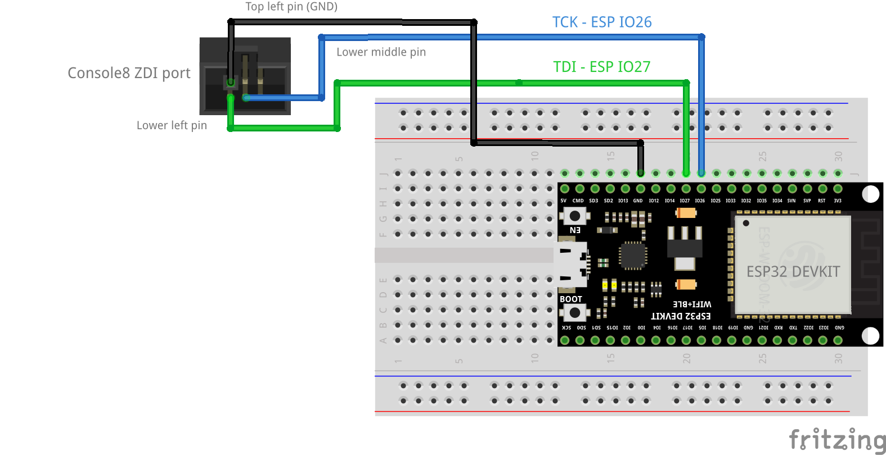

# Upstream ZDI connector diagram provenance

This is the canonical visual reference alongside Extender's maintained MOS
recovery procedure. It preserves the exact original diagram, so future recovery
work can identify the connector in the same notch-at-top view as the Author.
The original WROOM GPIO numbers must not be substituted for the P4 mapping.

- File: [zdi.png](zdi.png), original upstream bytes, unmodified.
- Author: Jeroen Venema (`envenomator`), Agon recovery utility.
- Upstream repository: https://github.com/AgonPlatform/agon-recovery
- Cabling instructions: https://github.com/AgonPlatform/agon-recovery#cabling-details
- Author-supplied image URL: https://github.com/AgonPlatform/agon-recovery/raw/master/media/zdi.png
- Downloaded raw URL: https://raw.githubusercontent.com/AgonPlatform/agon-recovery/master/media/zdi.png
- Pinned reference: https://github.com/AgonPlatform/agon-recovery/blob/95d68464afd049945e1dfd780c1c07621d565450/media/zdi.png
- Introducing commit: `b73365dffeb5a01dabae2f2b2a5e85a6a72ff989`, 2024-04-15, “ZDI connector overview”.
- Retrieved and archived: 2026-10-30, America/New_York date.
- SHA-256: `88d754f970d5611ed7adc06dd851b0a054e67f5a9cc462f4835c910e09c49064`.
- Size: 12885 bytes; PNG, 648 × 378 pixels.
- Cross-check: download matches the image in locally retained upstream commit
  `95d68464afd049945e1dfd780c1c07621d565450` byte-for-byte.
- License: MIT; Copyright (c) 2024 Jeroen Venema. The complete upstream notice
  accompanies this copy in [LICENSE.agon-recovery.txt](LICENSE.agon-recovery.txt).

## Reading this view

The connector notch is at the top. Top row left-to-right:5,3,1. Bottom row:
6,4,2. WROOM GPIO26/clock connects to pin4 (BLUE in the diagram); WROOM
GPIO27/data connects to pin6 (GREEN in the diagram). Ground is shown at pin5;
pin3 is also ground. No connection to pin1/+3.3V or pin2/reset is called for.

The diagram's colors are the reverse of the earlier local convention
GREEN=clock/BLUE=data. On2026-10-30 the Author directed matching this diagram:
**BLUE=clock/TCK, GREEN=data/TDI**. Preserve earlier test logs and diagrams as
historical records; their recorded colors must not be silently rewritten.
The Author announced a forthcoming wire swap; archiving this diagram does not
prove that the physical change has already happened or independently establish
which target pins the earlier wires actually reached. Pause bench operations
while rewiring and obtain the updated physical handback before testing again.

For the maintained P4 recovery programmer the signal functions remain
GPIO46=clock/TCK and GPIO47=data/TDI. GPIO26/27 in this image describe WROOM,
not the P4. See the maintained procedure's separate P4 wiring table.

## Console8-to-WROOM breadboard diagram

This second original diagram agrees with the connector diagram above:
BLUE connects WROOM GPIO26 to lower-middle ZDI pin4/TCK; GREEN connects
GPIO27 to lower-left pin6/TDI. The illustrated ground lead reaches the upper-left
ZDI ground, pin5. Ground-wire color is not prescribed for the Author's bench.
The illustration's development-board layout is an example; use actual GPIO
labels, not header-position counting on a different WROOM board.

- File: [console8_zdi.png](console8_zdi.png), unmodified upstream bytes.
- Author: Jeroen Venema (`envenomator`), Agon recovery utility; illustration
  carries a Fritzing mark, preserved in the original.
- Author-supplied page: https://github.com/AgonPlatform/agon-recovery/blob/master/media/console8_zdi.png
- Downloaded raw image: https://raw.githubusercontent.com/AgonPlatform/agon-recovery/master/media/console8_zdi.png
- Pinned reference: https://github.com/AgonPlatform/agon-recovery/blob/95d68464afd049945e1dfd780c1c07621d565450/media/console8_zdi.png
- Last image commit at that revision: `042d16ede874635f6fc362293fddcc5f8fc43d64`, 2024-04-15, “First source commit”.
- Retrieved/archived: 2026-10-30, America/New_York date.
- SHA-256: `725fd01e1ee2c1bc37972377e42c5c29b9dd81b1d0a96d5b59f26fc341dac90e`.
- Size: 182172 bytes; PNG, 1575 × 810 pixels.
- Download matches the pinned local upstream image byte-for-byte.
- License: upstream MIT, Copyright (c) 2024 Jeroen Venema;
  [full notice](LICENSE.agon-recovery.txt) accompanies both diagrams.

The Author announced wiring BLUE to26 and GREEN to27. This remains an intended
rewiring handoff until the Author reports that wiring is complete; no hardware
command is authorized by preserving these diagrams.
