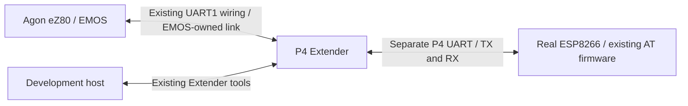

# NET-008 — Temporary ESP8266 development through a second P4 UART

Let the Author develop and test software for ESP8266-only Agons while retaining
Extender's on-hardware deployment and debugging tools. Attach the real ESP8266
to a separate P4 UART and expose it through an EMOS-owned development adapter.
This is a temporary development aid, not a new permanent network architecture.
It is secondary to PARALLEL-001 and current support for other agents.

## Frozen authority and boundaries

Smith selects this work on2026-11-06: put the ESP8266 on Extender so mainboard
UART1 can select the Extender service or the modem. Software control is preferred;
a single74-series chip was initially allowed. Smith then explicitly approves a
separate UART on the P4 side, describes this as temporary, and defines its
purpose as iterative development for ESP8266-only Agons using Extender tools.
The separate-UART choice supersedes the exploratory mux option. No mux purchase,
new permanent operating mode or broad wireless-backend migration is selected.

The plan is frozen with its exact bytes in `NET-008/FREEZE-R01.json` before
implementation. Later material scope changes require a new revision and explicit
traceability; preserve this baseline. Freeze means fixed work boundaries, not
that unverified GPIOs, a numeric ABI or a final firmware pair are already chosen.
No new persistent goal is created: the existing parallel goal remains primary.

## Selected topology and compatibility

1. The P4 retains its current mainboard UART connection and uses a different
   UART controller and separately verified header GPIOs for the ESP8266.
   The P4 bridges bytes; EMOS owns eZ80 admission, service selection, receive
   dispatch and return to ordinary operation. No two push-pull TX outputs are
   tied together and no time-slicing of one UART is assumed lossless.
2. Keep ordinary mainboard VDP output on its existing UART0 route. Preserve
   Extender deployment/debug access; finish a modem operation before any
   incompatible file-transfer/parallel handover. Returning from the app must
   leave those tools usable without rewiring or firmware replacement.
3. The first development client is project-owned Wi-Fi setup/startup support,
   using the real existing ESP8266 AT firmware. Keep credentials in private cfg,
   DHCP reservation outside the application, redacted logs and bounded waits.
   Reuse existing unchanged Radiotux references; do not patch upstream utilities.
4. The deliverable for an ESP8266-only Agon must not require Extender. Prefer
   one application source with a small explicit development backend and a
   vanilla-MOS backend. Where the normal MOS UART API can be preserved cheaply,
   check the same binary; do not promise identical binaries before source proof.
   Direct UART-register/IRQ/OTIRX code cannot transparently address a remote
   P4 peripheral. Extender owns its adaptation; UART keeps its generic driver.
5. A framed development byte service can keep modem bytes separate from P4
   keyboard/control packets. Do not feed arbitrary AT/TCP bytes to the VDP/key
   parser, impersonate a stock UART ISR, or introduce a supported raw-pin bypass.
   If a cheap compatible adapter cannot preserve required services, record the
   concrete resource/compatibility limit before expanding the design.
6. The ESP8266 remains the actual modem. This is not P4 Ethernet emulating
   successful AT/Wi-Fi replies. No ESP8266 firmware replacement, invented flow
   control, hidden retry/reconnect, interprocessor CRC or silent carrier fallback.

## Decision register

| ID | State | Decision / owner |
|---|---|---|
| N08-D01 | Author selected | Temporary iterative development aid for ESP8266-only Agons; preserve Extender tools on hardware. |
| N08-D02 | Author selected | Separate P4 UART and lines; software selection. No74-series mux in the selected implementation. |
| N08-D03 | Author selected | Secondary work only when not managing higher-priority agent work; PARALLEL-001 stays active. |
| N08-D04 | Existing rule | EMOS owns mainboard transport/receive/service lifecycle; P4 owns its second UART and buffers. |
| N08-D05 | Owner evidence pending | Exact target P4 board/revision, UART instance, two exposed unused GPIOs and available3.3V power budget. Verify against actual schematic and enabled pin map before wiring. |
| N08-D06 | Owner source decision pending | Smallest EMOS/application development adapter preserving ordinary tools and portable vanilla build; show ROM/app/BSS cost before choosing a resident change. |
| N08-D07 | Owner evidence pending | Bounded buffer sizes, upstream backpressure and downstream AT pacing/unsolicited receive limits at existing module baud. |
| N08-D08 | Owner evidence pending | Session close/reset/recovery and how normal P4 keyboard/control traffic coexists with modem bytes. |

N08-D05 is the first design decision to close: recommend an unused hardware UART
mapped to two genuinely spare3.3V header GPIOs. Check the old P4 DevKit separately
from P4-PC; a spare SoC UART is not proof of available board pins. Alternative
GPIOs remain within the selected separate-UART design; do not silently borrow
active Port C data lanes, READY/CLOCK/VALID, display, SD, USB, Ethernet or boot pins.

## Bounded research précis

1. Official MOS [UART APIs](../../../../agon-docs/docs/mos/API.md), reviewed
   baseline `f9806bd3cbff6ed5d1c08bef1d51fed11764b86b`:15h open,16h close,
   17h receive,18h send; UART1 interrupt vector1Ah. Carry means success for byte
   calls; receive blocks while open. Official MOSv3.0.2 and VDPv2.16.0 reference
   checkouts are clean at their exact release tags. Polling adapter cancellation
   must not inherit an indefinitely blocking receive call.
2. [ESP32-P4 v1.3 datasheet, UART controller/pin assignment](https://documentation.espressif.com/esp32-p4-chip-revision-v1.3_datasheet_en.html):
   five HP UART controllers plus LP UART, GPIO-matrix routing. This establishes
   a silicon capability only. Pin allocation, IDF support and current firmware
   resources must be proved for the selected board/build before implementation.
3. Maintained P4 UART ownership/parking lives under
   `vdp/video/extender/transport/`; current mainboard owner uses UART_NUM_1.
   Do not edit private diagnostic snapshots as maintained source or assume
   another controller's pins from an old diagnostic. Current board map and
   exact target schematic still require a bounded source review.
4. [NET-006](NET-006.md)/[NET-007](NET-007.md) retain the real module's
   AT1.3.0.0/SDK2.0.0 identity and1152008N1 TX/RX-only behavior. Its four-wire
   module header provides noRTS/CTS. P4/mainboard flow control does not create
   modem flow control; bounded AT request/response and counted data must account
   for unsolicited modem bytes and explicit overruns.
5. [Architecture](../architecture.md) preserves EMOS routing/activation and
   separates the optional wireless backend from a modem driver. This task does
   not adopt that larger backend. [UART1 placement](../decisions/ADR-2026-11-06-application-uart1-async-driver.md)
   keeps the generic async engine/application storage out of resident EMOS.
6. Initial alternative only: [TI CD74HC4053 datasheet](https://www.ti.com/lit/ds/symlink/cd74hc4053.pdf),
   triple two-way analog switches with inhibit/break-before-make. The HC supply
   range includes3.3V; HCT is not an interchangeable3.3V choice. A mux still
   needs quiescence, defined reset selects and RTS/CTS disposition. Smith's
   separate-UART choice means no circuit/wiring implementation is selected.

## Work and gates

N08-01 Publish task/TODO, accepted temporary topology/priority decision and
  exact plan freeze before implementation. Commit/push the record. [x]

N08-02 When higher-priority work permits, audit target board schematic and
  enabled source/configuration; publish a pin/power allocation with full header
  diagram, existing harness colors and probe colors. Resolve orientation using
  measured/documented evidence; give breadboard-hole offsets from colored wires
  for Author construction, not unreadable pin-number-only directions. No
  construction or power-on based on an assumed free header. [ ]

N08-03 Propose the smallest service/adapter with explicit endpoint/byte routing,
  buffer budget, flow-control limits, API compatibility, keyboard/control
  coexistence, exclusive transfer arbitration and positive close. Record all
  ownership/state/error outcomes, bounded Escape behavior and byte lifetimes.
  Consult UART only on concrete generic-driver contract gaps; do not reassign
  its implementation or require a generic driver rewrite. [ ]

N08-04 Implement a separately selectable temporary build/adapter in maintained
  owner source. Keep vanilla target app free of Extender runtime dependencies,
  upstream files unchanged, normal startup/private cfg intact and removal path
  explicit. Build/check under normal Pi FIFO; retain exact source/config/map/
  binary and RAM/ROM cost. No Oryx while unavailable. [ ]

N08-05 Freeze a finite on-hardware test plan and exact matched pair/rollback,
  then use normal Olimex admission or Smith's manual Console8 invocation as
  applicable. Test real AT identity, association/DHCP, byte-exact bounded echo,
  unsolicited replies/overrun, Escape/timeouts, normal tools before/after and
  repeated select/close. Distinguish local acceptance, peer receipt and network
  success; preserve first failures, no uncertain replay. All selected cleanup
  precedes lease release; no bench preemption or test autoexec edits. [ ]

N08-06 Compare the portable app on an8266-only Agon, record limits and retain
  a straightforward temporary-adapter removal/rollback procedure. No production
  promotion, permanent protocol/API freeze or public release inferred. [ ]

No build, wiring instruction, hardware access or firmware change occurred while
writing this frozen task. Higher-priority parallel/consumer work continues.

## Task-local pin proposal — 2026-11-09

Smith now prioritizes ESP8266 work and requests identification of the new pins
on the existing complete harness drawing. He explicitly requires the derivative
diagram to remain siloed in this task. The [pin proposal](NET-008/PIN-SELECTION.md)
and [complete annotated drawing](NET-008/ESP8266-WIRING.svg) retain every existing
harness wire and show proposed UART2 TX GPIO47/EXT1-19 → modem RXD, RX
GPIO48/EXT1-20 ← modem TXD, common ground EXT1-3 and conditional3.3V supply EXT1-1.
Their earlier proposed ZDI use remains an explicit allocation tradeoff. Source
pin/header checks and visual inspection pass; N08-02 remains partial until
module power margin and final construction facts are established. The base
harness, native board profile and historical freeze remain unchanged. No
wiring, firmware implementation or hardware operation is performed by this proposal.

## Author wiring completion — 2026-11-09

Smith reports the wiring done and identifies the P4 RX lead (EXT1-20/GPIO48,
from modem TXD) as **orange**, matching the Console8 wiring. The task-only
drawing, generator and pin table now use orange for that connection. This is
a construction report, not an independent electrical/power or communications
qualification; no firmware configuration or device operation accompanied this
record update. The base harness and maintained pin profile remain unchanged.

## First real wiring test — 2026-11-09

Smith reports construction complete and corrects the RX48 wire to orange, matching
Console8. Under his explicitly held reservation, actual164's separately admitted
P4-only diagnostic accepts one explicit START. First AT at1152008N1 receives zero
bytes within its2s bound; later commands remain unrun and UART2 retires. This
establishes no modem identity or functioning link. The exact incoming P4 image
is restored through selective application-prefix write/readback; ordinary input,
whole startup/listener reads, positive EXIT and all process/serial closure pass.
The [wiring test record](NET-008/WIRING-TEST.md) distinguishes the failed AT
result from successful restoration. Bench custody remains held for Smith;
no automatic release or replay. Full EMOS adapter/network work remains pending.

## Iterative bring-up and working pin reversal

Smith corrects the stopping point: continue firmware development until the real
ESP8266 works and bandwidth limits are measured, and do not restore the original
image after each iteration. He selects TX48/RX47 in software and explicitly says
to test it before inspecting the modem-end wires. The [current bring-up record](NET-008/BRINGUP-R02.md)
supersedes the earlier one-shot restoration plan.

Actual164-r02 passes AT, GMR and three subsequent AT commands with this mapping,
without physical rewiring. The modem reports AT1.3.0.0/SDK2.0.0. The task-only
full wiring diagram retains the existing colours and now shows GPIO48 TX and
GPIO47 RX. The independently verified e3485b12 development application remains
installed, with UART retired and host children joined; normal P4 product
services are paused. Bench remains held, no original-image restoration/release.
UART/Wi-Fi bulk bandwidth measurements and the full EMOS adapter remain pending.
